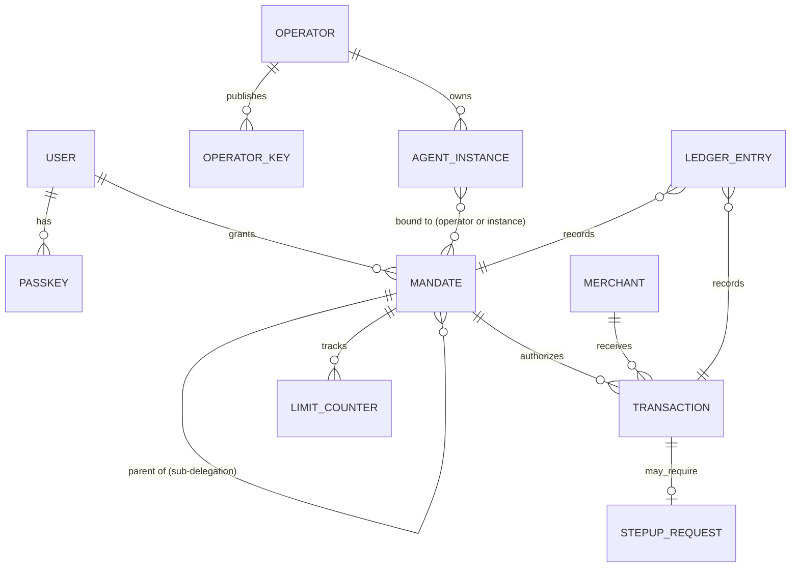

# 데이터 모델

## 테이블 정의 (PostgreSQL)

### operator
| 컬럼 | 타입 | 설명 |
|---|---|---|
| id | text PK | `op_` + ULID |
| legal_name | text | |
| domain | text unique | 도메인 소유 증명 대상 |
| trust_tier | enum(`registered`,`verified`,`certified`,`suspended`) | |
| jwks_uri | text | 운영사 공개키 위치 (또는 직접 등록) |
| created_at, updated_at | timestamptz | |

### operator_key
| id (kid) text PK | operator_id FK | jwk jsonb | status enum(`active`,`retired`,`revoked`) | not_after timestamptz |

### agent_instance
| 컬럼 | 타입 | 설명 |
|---|---|---|
| id | text PK | `agt_` + ULID |
| operator_id | FK | |
| public_jwk | jsonb | 인스턴스 서명 키 (Ed25519) |
| jkt | text unique | RFC 7638 JWK 썸프린트 — 토큰 `cnf.jkt`와 매칭 |
| software_id / version | text | 에이전트 소프트웨어 식별 |
| expires_at | timestamptz | ≤ 24h |
| status | enum(`active`,`revoked`) | |

### user / passkey
- `user(id 'usr_', home_region, created_at)` — PII는 별도 `user_profile`(암호화 컬럼, 리전 고정)
- `passkey(credential_id PK, user_id, public_key cose, sign_count, transports, created_at)`

### mandate
| 컬럼 | 타입 | 설명 |
|---|---|---|
| id | text PK | `mdt_{region}_` + ULID |
| user_id | FK | |
| operator_id | FK | 필수 바인딩 |
| agent_instance_jkt | text null | null = 운영사의 모든 인스턴스 (단, 토큰은 항상 인스턴스 키 바인딩) |
| parent_id | FK null | 재위임 |
| depth | int | 0 = 원 Mandate |
| constraints | jsonb | §protocol `constraints` 스키마 그대로 저장 |
| consent_summary | text | 사용자에게 보여준 문구 |
| consent_hash | text | SHA-256(summary ‖ canonical(constraints)) |
| webauthn_assertion | jsonb | 사용자 승인 원본 증빙 |
| status_list_idx | int | Status List 내 위치 |
| status | enum(`active`,`revoked`,`expired`,`exhausted`) | |
| not_before / expires_at | timestamptz | |
| jwt | text | 발급된 Mandate 원본 (불변) |

### limit_counter (Redis 핫, PostgreSQL 영속)
- 키: `lim:{mandate_id}:{window}` (예: `period:2026-10`, `count:total`)
- 값: `reserved`, `captured` (최소 통화 단위 정수)
- 연산: Lua 스크립트로 `check-and-reserve` 원자 처리, Tx Token 만료 시 예약 해제

### transaction
| 컬럼 | 타입 | 설명 |
|---|---|---|
| jti | text PK | Transaction Token ID |
| mandate_id | FK | |
| merchant_id | FK | |
| cart_hash | text | |
| amount_reserved / amount_captured | bigint | 최소 통화 단위 |
| currency | char(3) | |
| risk_score | numeric(3,2) | |
| decision | enum(`allow`,`step_up`,`deny`) | |
| status | enum(`issued`,`captured`,`voided`,`expired`) | |
| stepup_id | FK null | |

### merchant
| id 'mch_' | name | domains text[] | webhook_url | policy jsonb (예: `min_operator_tier`, `require_stepup_over`) | verification_jwk (capture 호출 인증용) |

### ledger_entry (append-only)
| 컬럼 | 타입 | 설명 |
|---|---|---|
| seq | bigint PK | 리전별 단조 증가 |
| prev_hash | bytea | 직전 엔트리 해시 |
| event_type | text | `mandate.issued`, `token.exchanged`, `stepup.approved`, `tx.captured`, `mandate.revoked` … |
| subject_id | text | mandate id / jti |
| payload_hash | bytea | 이벤트 페이로드 SHA-256 (원문은 별도 저장, 개인정보 삭제 대응) |
| entry_hash | bytea | SHA-256(seq ‖ prev_hash ‖ event_type ‖ subject_id ‖ payload_hash ‖ ts) |
| ts | timestamptz | |
| checkpoint_sig | bytea null | 매 N건/1분마다 AgentPass 키로 서명한 체크포인트 |

> 개인정보 삭제 요청 시 원문 페이로드만 삭제하고 해시 체인은 유지 → 무결성과 삭제권 양립.
