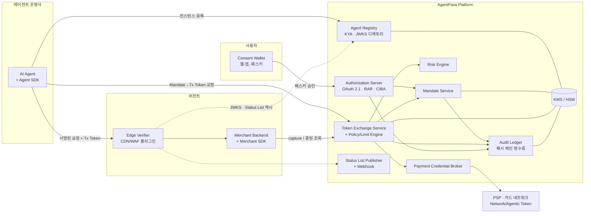
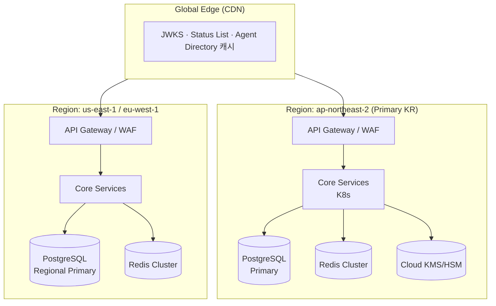

# 시스템 아키텍처

## 1. 신뢰 모델 — 세 가지 질문

머천트가 에이전트 요청을 받았을 때 답해야 하는 질문은 셋이며, AgentPass는 각각을 별도 증명으로 분리한다.

| 질문 | 증명 | 발급자 | 검증 수단 |
|---|---|---|---|
| ① **누가** 보냈나? (Agent Identity) | HTTP Message Signature + Instance Assertion | 운영사가 인스턴스에, AgentPass가 운영사에 | 공개 JWKS 디렉토리 (오프라인 캐시 가능) |
| ② **누구를 대신해** 무엇을 해도 되나? (Delegation) | Mandate (사용자 패스키 서명 포함) | AgentPass (사용자 승인 기반) | AgentPass 서명 검증 + Status List |
| ③ **이번 거래**가 그 권한 범위 안인가? (Transaction) | Transaction Token (cart hash, amount, merchant 고정, 1회용) | AgentPass Token Service (한도 평가 후) | 서명 + `cnf` 키 바인딩 + cart hash |

①②③을 분리했기 때문에, 상품 조회(UC-4)는 ①만, 주문 조회(UC-8)는 ①+②, 구매(UC-5)는 ①+②+③을 요구하는 식으로 **행위별 증명 수준을 조절**할 수 있다.

## 2. 컴포넌트 구성

| 컴포넌트 | 책임 | 상태 저장 | 비고 |
|---|---|---|---|
| **Agent Registry** | 운영사 KYA/KYB, 인스턴스 등록, 키 디렉토리(`/.well-known/agentpass/jwks`), 신뢰 등급 | PostgreSQL | 읽기 트래픽은 CDN 캐시 |
| **Authorization Server** | OAuth 2.1 (authorization code + PKCE, RAR, CIBA, Token Exchange 엔드포인트), 사용자 인증(패스키) | PostgreSQL, Redis(세션) | 기성 OSS(예: Ory Hydra) 확장 vs 자체 구현은 ADR-0008 |
| **Mandate Service** | Mandate 생성·조회·철회, 사람이 읽는 요약 생성, 재위임 범위 검사 | PostgreSQL | Mandate 원본은 불변(immutable), 상태만 변경 |
| **Token Exchange Service** | Mandate → Transaction Token, 누적 한도 차감(예약/확정), Step-up 분기 | Redis(한도 카운터, nonce), PostgreSQL | 핫패스. 한도 차감은 원자적 연산 |
| **Policy/Limit Engine** | Mandate 제약 + 사용자/머천트 정책 평가 | 무상태 | 정책 = 선언형 JSON, 테스트 가능 |
| **Risk Engine** | 위험 점수(0~1): 운영사 등급, 속도, 기기/IP 평판, 머천트 이력 | Feature store | v1은 규칙 기반 + 점수, v2 ML |
| **Payment Credential Broker** | PSP 어댑터(Stripe SPT, Visa/MC 에이전트 토큰, 국내 PG 빌링키) | 토큰 참조만 | PAN 미보관 (ADR-0004) |
| **Audit Ledger** | 이벤트 영수증 해시 체인, 주기적 체크포인트 서명·외부 공증 | Append-only 테이블 + 객체 스토리지 | ADR-0007 |
| **Status List Publisher** | Mandate/키 철회 상태 비트맵 발행(30초 주기), Webhook 푸시 | 객체 스토리지 + CDN | ADR-0006 |
| **Consent Wallet** | 사용자 UI: Mandate 생성 마법사, 내역, 철회, Step-up 승인 | — | 웹 + iOS/Android, 푸시 |
| **Edge Verifier / Merchant SDK** | 서명·토큰 오프라인 검증, 정책 훅 | 로컬 캐시 | 오픈소스 공개 |

## 3. 핵심 설계 원칙

1. **오프라인 검증 우선**: 머천트 핫패스에서 AgentPass API를 호출하지 않아도 검증이 끝나야 한다(JWKS·Status List 캐시). AgentPass 장애가 머천트 장애가 되지 않게.
2. **모든 토큰은 송신자 제약**: Bearer 토큰 없음. `cnf.jkt` 로 에이전트 인스턴스 키에 바인딩.
3. **범위 축소만 가능(Attenuation)**: 토큰 교환·재위임 시 권한은 줄어들 수만 있다.
4. **사람이 읽은 것에 서명**: 사용자가 본 요약 문구의 해시를 Mandate에 포함 → "나는 그런 동의를 한 적 없다" 분쟁 대응.
5. **단명 + 철회 가능**: 인스턴스 키 ≤ 24h, Transaction Token ≤ 5분, Mandate는 철회 가능.
6. **표준 우선, 어댑터로 확장**: 코어는 OAuth/JOSE, 외부 프로토콜(AP2, ACP, Visa TAP, MC Agent Pay)은 어댑터.

## 4. 배포 아키텍처

- **데이터 거주성**: 사용자·Mandate 데이터는 사용자 홈 리전에 저장(KR/US/EU). 운영사·키 디렉토리는 전역 복제.
- **한도 카운터**: 사용자 홈 리전의 Redis에서만 차감(단일 쓰기 리전) → 이중 지출 방지. 다른 리전 요청은 홈 리전으로 라우팅(mandate id에 리전 prefix).
- **서명 키**: 리전별 KMS. `kid`에 리전 포함. 키 회전 90일, 이전 키는 검증용으로 30일 유지.

## 5. 장애 시 동작 (Degradation)

| 장애 | 영향 | 동작 |
|---|---|---|
| Token Exchange 장애 | 신규 구매 불가 | 에이전트는 재시도; 조회(①만 필요)는 정상. 머천트는 정책에 따라 "사람 결제로 전환" 링크 제공 |
| Status List 갱신 지연 | 철회 반영 지연 | 머천트 SDK는 `max_staleness`(기본 5분) 초과 시 고위험 행위 거부(fail-closed) |
| Registry 장애 | 신규 인스턴스 등록 불가 | 기존 인스턴스(캐시된 JWKS)는 정상 |
| Risk Engine 장애 | 점수 산출 불가 | 기본 점수 0.5 적용 → Medium 정책(알림) / High 조건은 그대로 Step-up |
